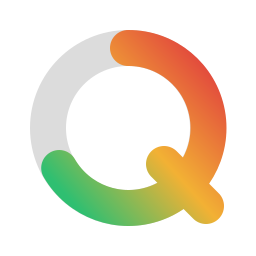
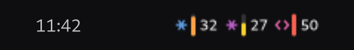

<div align="center">



# quartermaster

**How much quota you have left — in every agent account on the machine.**
Every Claude Code profile, not just the default one, plus Codex, Antigravity,
and the providers stored by opencode.

[Landing](https://quartermaster.legios.com.ar/) ·
[Install](#install) ·
[Releases](https://github.com/legiosai/quartermaster/releases) ·
[Security](SECURITY.md) ·
[En castellano](LEEME.md) ·
MIT

<sub>An instrument by</sub><br>
<a href="https://github.com/legiosai"><picture>
  <source media="(prefers-color-scheme: dark)" srcset="docs/legios.svg">
  <source media="(prefers-color-scheme: light)" srcset="docs/legios-claro.svg">
  
</picture></a>



</div>

```sh
brew install legiosai/tap/quartermaster        # macOS and Linux
npm install -g @legios/quartermaster           # anywhere
```

<div align="center"><sub>Then run <code>qm</code>. Details, the bar item and Windows: <a href="#install">Install</a>.</sub></div>

> **Mission.** Nobody should find out their quota is gone by hitting the wall.

## The problem

Claude Code supports several profiles through `CLAUDE_CONFIG_DIR`, and each one
has its own account and its own credential. A work seat and a personal
subscription on the same laptop is ordinary.

Every monitor out there reads **one** credential: the default directory's. On
the machine this was written on, that means reading `~/.claude` — which is
empty — while the two real accounts live in `~/.claude-personal` and
`~/.claude-teams`. The observed result was a monitor polling every 120 seconds
for hours, logging `credential expired — gating poll`, and displaying nothing.

quartermaster finds every account, and reads the number from disk.

## Install

```sh
brew install legiosai/tap/quartermaster        # macOS and Linux
npm install -g @legios/quartermaster           # anywhere
```

**The bar item, on all three:** the first time you run `qm` in a terminal, it
asks once whether to put it in the bar and start it at every login — the menu
bar on macOS, the top bar on GNOME, the notification area on Windows. The
install itself can't: brew can't start anything from a formula, the `.deb` drops
the files and leaves, npm's postinstall won't register anything either, and a
tool that reads OAuth tokens shouldn't register login agents nobody asked for.
Without the question: `brew services start quartermaster` on macOS, and

```sh
qm-indicator --instalar-extension   # Linux: the item that opens the panel on click
qm-indicator --instalar-arranque    # and start it once: qm-indicator &
bin/qm-tray --instalar-arranque     # Windows, from WSL: then run bin/qm-tray
```

Saying yes on Linux **also installs the GNOME extension**, which is what makes a
click open the panel: without it the item is hosted by AppIndicator and the click
falls through to the GTK menu — the one that does not hold the grab and closes
the moment you touch it. GNOME does not load a freshly installed extension on
Wayland, so when it had to be installed the closing line says so and you have to
log out once.

The question only appears when there is somewhere to show it: a graphical
session, `python3-gi` with `AyatanaAppIndicator3`, and a host for the item — an
extension already in place, or a GNOME Shell to install ours into. Without those
the process would start anyway and nothing would appear up there, which is worse
than not offering. `qm --diagnostico` says which one is missing.

**Windows:** `npm install -g @legios/quartermaster` inside WSL works too, and
the first `qm` asks the same question — the tray ships in the package. For a
native install without WSL, the installer from the [latest
release](https://github.com/legiosai/quartermaster/releases/latest). Per-user
and no UAC: it puts `qm` on your `PATH`, the tray in the Start menu, and — if
you leave the box ticked — the tray in startup.

**Debian and Ubuntu:** the `.deb` from the same release, or the signed apt repo
([two lines](LEEME.md#instalar)).

**Arch:** a `PKGBUILD` in [`paquetes/aur/`](paquetes/aur/PKGBUILD) — not on the AUR yet.
**Nix:** `nix run github:legiosai/quartermaster`.

Needs **Node >= 22.6**: `qm` reads its own TypeScript with no build step, and
type stripping starts there. The launcher looks for a usable Node on the `PATH`
and in nvm, fnm and volta; if it cannot find one it says so and explains how to
get one, rather than dying with a syntax error.

**Shell completion** for bash and zsh — the flags, and your account names for
`--solo=`, `--ocultar=` and `--cuentas=` — comes with the `.deb` and with
`make instalar`. The files are in [`paquetes/completions/`](paquetes/completions/).

## Use

```sh
qm                  # quota and usage for every account
qm --statusline     # one line, for Claude Code's statusLine — and it records
                    # the quota Claude Code hands it, no network, no credential
qm --breve          # the quota part of that line, without reading stdin
qm --todas          # dormant accounts in full, not one line each at the bottom
qm --json           # the same, for scripts and panels
qm --refrescar      # also ask the endpoint (needs a live token)
qm --watch 60       # redraw every N seconds
qm --umbral=80      # exit 3 if any bar is over N%
qm --esperar        # block until quota drops:  qm --esperar && codex ...
qm --mejor -- claude  # start claude in the profile with the most room left
qm --aviso          # a UserPromptSubmit hook: warns inside Claude Code
qm --diagnostico    # everything a bug report needs, already redacted
qm --desglose       # where the week's quota went — disk only, never the network
qm --idioma=es      # this run in Spanish (or =en); QM_IDIOMA does it for good
```

In Claude Code's `settings.json`:

```json
{ "statusLine": { "type": "command", "command": "qm --statusline" } }
```

**Put it here even if you never look at the line.** Claude Code no longer
leaves the quota in `.claude.json` on every use; what it does do is pass the
statusline command a `rate_limits` object on every redraw — the session and
weekly percentages from the last API response. `qm --statusline` saves that
per profile, so every other `qm` (the terminal, `--json`, the panels) has a
number that is seconds old and cost no request. It carries only those two
bars, so it is laid **over** the last endpoint reading rather than replacing
it: a model-scoped bar the statusline does not know about keeps its value and
shows its own age.

Already have a statusline script? Pipe the event through and print what comes
back: `echo "$input" | qm --statusline`.

```
ctx 182k · cache 12m · personal 23/75%! · teams 9/42% · codex 49/59%
```

The first two segments are the session drawing the line, and they are what the
*next* prompt will cost: the context size (yellow from 400k — prompts that big
were 35 % of a measured week's weighted cost with 16 % of the requests) and
how long the prompt cache stays warm. Once it goes cold the line says
`cold cache (+181k)`: the next request rewrites that many tokens of cache, so
that is the moment to decide between `/clear` and carrying on. `--breve` prints
only the quota part.

**Two numbers per account, on purpose.** The first is the session; the second is
the bar that stops you first. They answer different questions — "can I keep
going right now?" and "do I make it to the end of the week?" — and either one
alone is half an answer.

A model-scoped bar says which model: `main 75% Fable`. A bar the server sends
without a name stays out of the line until it reaches 90 % — where `--aviso`
starts warning — and then shows with its name, `main 92% iguana_necktie`; below
that you see the weekly. The full table always lists every bar.

### Language

`qm` speaks English or Spanish, picked from the locale the way any terminal
program does: the first non-empty of `LC_ALL`, `LC_MESSAGES` and `LANG` — `es*`
is Spanish, anything else (including `C` and `C.UTF-8`) is English — and on
Windows, where those are usually unset, the system's regional setting.
`QM_IDIOMA=es` or `QM_IDIOMA=en` overrides it for good, `--idioma=` for one run.
A Spanish speaker on a machine with `LC_ALL=C.UTF-8` gets English until they set
`QM_IDIOMA=es`. The `--aviso` hook runs with Claude Code's environment, so its
warning follows the same rule.

`--json` is the exception. The four panels draw its sentences (`frase`,
`nombre`, `credencial`, `porque`) next to labels of their own that are still in
Spanish, and a panel with half its words in each language reads worse than one
in Spanish. So the JSON's text stays Spanish unless you ask for a language on
purpose with `QM_IDIOMA` or `--idioma`. Its keys never change.

## Before the wall

**`qm --mejor`** picks the Claude profile with the most room right now: the
lowest binding bar, then a projection that hits 100% before the reset counts
against it, then the emptier session. A window whose reset already passed is
*unknown*, not 0%. Profiles with no session or no stored number are left out.

```sh
qm --mejor -- claude        # start claude there
qm --mejor                  # just print the directory, for scripts
qm --mejor --json           # the whole ranking, and why
```

Use the `--` form to launch. `CLAUDE_CONFIG_DIR=$(qm --mejor) claude` is wrong
for the default profile: with the variable set, even to `~/.claude`, Claude
Code reads `~/.claude/.claude.json` instead of `~/.claude.json`, and on macOS
it stops looking in the keychain — a different profile, with no session.
`qm --mejor -- …` removes the variable for the default profile.

**`qm --aviso`** is a hook that warns you *inside* Claude Code, where you are
looking, before the bar stops you. In the profile's `settings.json`:

```json
{
  "hooks": {
    "UserPromptSubmit": [
      { "hooks": [{ "type": "command", "command": "qm --aviso" }] }
    ]
  }
}
```

```
qm · main: iguana_necktie at 92 % · resets in 3d7h. teams has 94 % free: CLAUDE_CONFIG_DIR=~/.claude-teams claude
```

It speaks when the binding bar crosses 90% (`--umbral=N`), again at 95 and
100, and when the projection says you hit 100% before the reset within 30
minutes — once per step and per window, so it does not repeat on every
prompt. The message goes in `systemMessage`, which Claude Code shows to you and
not to the model; it never blocks the prompt and always exits 0. Disk only, like
`--breve`: it reads what `qm --statusline` and the bar left, so it needs one of
them to have a number.

## Where did it go?

`qm` tells you how much is left. `qm --desglose` tells you what spent it: the
same transcripts, broken down over the last 7 days (`--dias=N` for another
window), one block per account.

```
  .claude · ~/.claude
    7,909 requests · 282.1M of weighted cost (equivalent input tokens)

    what to do · shares of the weighted cost: they approximate the quota, they don't measure it
      · 35.0% of the cost came from prompts of 400k or more (16.3% of the
        requests). Every turn rereads the whole context: /compact or /clear
        before you get there makes every request after it cheaper.

    by token class
      cache read         ██████████░░░░░  67.6%   1.9G tokens
      write 1h           ██░░░░░░░░░░░░░  11.7%   16.5M tokens
      write 5m           ██░░░░░░░░░░░░░  11.9%   26.8M tokens
      output             █░░░░░░░░░░░░░░   8.8%   5.0M tokens
      input              ░░░░░░░░░░░░░░░   0.0%   15.9k tokens
    …
      400k or more: 35.0% of the cost in 1,288 requests (16.3% of the requests)
```

It opens with **what to do** — at most three tips per account, each one
carrying the measured number it rests on, ranked by how much of the cost it
explains: prompts of 400k or more (`/compact` or `/clear` sooner), cache
rewritten after a pause, an agent type that costs per request as much as the
main thread (a `fork` drags the whole conversation along) when a cheaper one is
in common use, or a few sessions taking most of the week. A tip appears only
when its number crosses a threshold; an account with nothing to fix gets no
generic advice. Then the evidence, five answers per account:

- **Cost by token class.** Tokens are weighted by their relative API price —
  cache read 0.1, cache write 1.25 (5-minute TTL) or 2 (1-hour TTL), input 1,
  output 5 — as a **proxy** for quota drain. Anthropic does not publish how a
  subscription weighs them, and the output says so every time.
- **Cost by prompt size**, in buckets from `<50k` to `>700k`, plus how much of
  it came from prompts of 400k or more.
- **Cache rebuilds**: requests that wrote more than 20k of cache without being
  the first of their transcript, split by how long the cache sat idle (over an
  hour, 5–60 minutes, or no gap) and by main thread vs subagent.
- **Subagents**: the main thread against each agent type.
- **The most expensive sessions**: requests, largest and median context,
  compactions and duration, with the project directory — never message
  content.

Requests are deduplicated by message and request id, because a reply with
several content blocks is written once per block with the same usage. Codex is
included when it is installed (its rollouts report usage per request; they do
not report cache writes or subagents, and the output says that instead of
printing zeros). `--json` gives the same numbers for a script, and
`--redactado` also replaces every project directory with `project 1`,
`project 2`… (`proyecto 1` in Spanish and in `--json`) and drops session ids, so the report can be pasted somewhere
public. Reading a week of transcripts — about 2 GB across two profiles — takes
about two seconds; see [`numeros/desglose.md`](numeros/desglose.md).

## When something is wrong

```sh
qm --diagnostico
```

One command, and you can paste the output straight into an issue: home paths
become `~`, and no e-mail, token or account id is ever printed.

It gathers what otherwise takes five commands nobody should have to know —
`gnome-extensions info`, `gdbus … GetExtensionErrors`, `journalctl --user -b`,
the cache directory, and `ps` for when the graphical session started — and it
**states the conclusion** rather than leaving you the data. The case that
prompted it:

```
  ⚠ extension.js is 12.9 h NEWER than the graphical session.
    The shell loads the module once and keeps it in memory: what is
    running is the old file …
      → log out and back in. It is the only step left.
```

Anything it cannot find out it says so — it never omits and never guesses. It
works with none of those commands installed.

**The GNOME item also writes what it does** to stderr, which systemd's journal
picks up when it starts from the autostart entry:

```sh
journalctl --user -b | grep qm-indicator
```

```
qm-indicator: pedido accion=actualizar
qm-indicator: calentar cuentas=.claude,.claude-teams,codex
qm-indicator: panel.abierto donde=arriba-derecha alto=1032
qm-indicator: panel.cerrado vivio_ms=3999
qm-indicator: panel.agarre-roto
qm-indicator: aviso clave=teams|weekly_all|2026-09-13T11:00|80 urgente=False
qm-indicator: qm.sin-datos motivo=qm salió 2: opción desconocida
```

The events, and the question each one answers:

| event | answers |
| --- | --- |
| `pedido` | did the click reach the indicator at all? |
| `calentar` / `calentar.fallo` | which accounts were re-read, and why a refresh did not happen |
| `panel.abierto` / `panel.cerrado` | `vivio_ms` — a panel that lived 40 ms was not closed by you |
| `panel.agarre-roto` | the compositor took the grab away |
| `aviso` / `aviso.repetido` / `aviso.fallo` | it fired, it was suppressed as a duplicate, or the notification server refused it |
| `qm.sin-datos` | why there is no number, instead of only a phrase on screen |
| `reinicio` | the process replaced itself because the source changed |
| `suspension.duerme` / `.vuelve` | the machine slept, and the quota was re-read on resume |
| `calentar.colgado` | a warm never called back and its flag was released after the deadline |

`vivio_ms` is the one that matters for "the panel closes on its own": a panel
that lives 40 ms was not closed by you. `QM_SILENCIO=1` turns it off.

**The macOS menu bar writes a log too**, timestamped and capped at 1 MB. With
brew it is `$(brew --prefix)/var/log/quartermaster.log`:

```
2026-09-14T11:40:02-03:00 [qm-barra] arranca · qm=/opt/homebrew/opt/quartermaster/libexec/bin/qm · pid 812
2026-09-14T11:40:03-03:00 [qm-barra] posición: ancho=125.0 x=985.0..1110.0 muescaDerechaMinX=825.0 pantalla=1470.0 escondido=false
2026-09-14T11:40:04-03:00 [qm-barra] calentar · .claude: sin credencial — corré: …
2026-09-14T12:02:10-03:00 [qm-barra] aviso: quartermaster · teams — …
2026-09-14T13:15:40-03:00 [qm-barra] calentado (--calentar) falló: salió 1
2026-09-14T13:21:41-03:00 [qm-barra] calentado volvió a andar
```

It writes changes, not repeats: the item's position once per screen when it
moves, a refresh or a read the first time it fails and again when it recovers,
why an account was not refreshed (once per reason), and every notification —
with a line if `osascript` did not show it.
`escondido=true` is the one to look for when the item does not appear: macOS
put it under the notch or ran out of room.

## Where you can see it

| | |
|---|---|
| **Terminal** | `qm`, and `qm --breve` for a statusline — it skips transcripts, so it takes milliseconds |
| **GNOME** | an item in the top bar, panel on the first click. Ships its own Shell extension, because the AppIndicator one eats the left click |
| **macOS** | the menu bar, with live text next to the icon |
| **Windows** | the notification area, with the percentage drawn inside the icon like a battery meter |
| **Browser** | `qm-web` — a local dashboard on `127.0.0.1` only. Works everywhere |
| **waybar** | [`paquetes/waybar/`](paquetes/waybar/) — for Hyprland, Sway and river |

All of them only draw. The CLI resolves which bar wins and emits the resolved
answer in `qm --json` (`mostrar`, `frena`, `sesion`, `semanal`); no renderer
reimplements a rule. That is a design rule with a scar behind it: the same
function once lived in Python, JavaScript and Swift at the same time.

## What it reads, and what leaves the machine

The number needs **no network and no credential**. Claude Code stores the last
quota response it got in each profile's `.claude.json`, so quartermaster reads
it from disk — which means it still works on a profile whose token expired,
the exact state the motivating monitor died in.

The only thing that ever leaves is one request per vendor, and only when you ask
for it (`--refrescar`, or `--calentar`, which is what the panels run):

```
GET https://api.anthropic.com/api/oauth/usage
GET https://api.z.ai/api/monitor/usage/quota/limit     # only if you use z.ai
```

Each one is the same host that vendor's own tool already talks to, with the
credential it already stored, asking about your own account, with a 60-second
floor. No account, no cloud, no telemetry, and zero runtime dependencies. **It
never refreshes a token** — a locked non-goal, with a test.

The z.ai one is the exception to "no credential", and it is worth knowing which
direction it runs: opencode stores GLM, MiniMax and Kimi plans as API keys, and
those plans leave no percentage anywhere on disk. The opencode rows therefore
show what disk can prove — tokens spent, and the reset time a `429` already told
you — and the percentage only after you ask for it once. It is cached like every
other number, so the panels get a bar without ever touching the key themselves.

The full table, and the straight paragraph about both endpoints being
undocumented, are in [`SECURITY.md`](SECURITY.md).

## Package managers

One tag publishes everywhere. `git push origin v0.1.7` runs the release
workflow, which builds every artifact and pushes it to each channel that has its
secret configured — and says in the log which ones it skipped and why.

| | Install | What it gets | Published by |
|---|---|---|---|
| **npm** | `npm install -g @legios/quartermaster` | the tarball with `dist/`, **with provenance** | the tag, automatically |
| **Homebrew** | `brew install legiosai/tap/quartermaster` | the formula, from the tag's tarball | the tag, automatically |
| **apt** | `sudo apt install quartermaster` | a **signed** repo, so `apt upgrade` brings new versions by itself | the tag, automatically |
| **`.deb`** | `sudo apt install ./quartermaster_*.deb` | the same package, standalone | attached to the release |
| **Windows installer** | `quartermaster-<v>-setup.exe` | per-user, no UAC: `qm` on `PATH`, tray in the Start menu | attached to the release |
| **scoop** | `scoop install quartermaster` | the portable zip, no installer | the tag, automatically |
| **AUR** | not available yet — `makepkg -si` from [`paquetes/aur/`](paquetes/aur/PKGBUILD) | `PKGBUILD`, with a real `nodejs>=22.6` | not yet: off until the AUR account exists |
| **Nix** | `nix run github:legiosai/quartermaster` | the flake, with its own Node in the closure | nothing to publish |
| **GNOME Extensions** | from the Extensions app | the Shell extension | **by hand** — no upload API |
| **waybar** | copy `paquetes/waybar/` | a module for Hyprland, Sway, river | copied by hand |

The one exception is extensions.gnome.org, which has no API for uploading. The
release reminds you, with a link to the artifact.

Cutting a version is one command:

```sh
./scripts/cortar-release.sh patch     # moves the version in all seven places,
                                      # runs the gates, commits and tags
git push origin main && git push origin v0.1.7
```

What each channel needs configured is in
[`paquetes/README.md`](paquetes/README.md).

## Design

```
src/core/         profiles, types. Knows nothing about keychains or HTTP.
src/adapters/     credentials (keychain / file), transcripts (JSONL), quota
                  from the cache (.claude.json) and from the endpoint (HTTP),
                  Codex (JSON-RPC), opencode (SQLite), z.ai (HTTP — the
                  only file that opens opencode's auth.json) and Antigravity
                  (SQLite per conversation, protobuf per request).
src/cli/          qm, and one demo per milestone.
src/render/       bars and formatting for the terminal, and the dashboard.
bin/              the launchers — qm (POSIX), qm.cmd + buscar-node.cmd
                  (Windows), qm.mjs (npm's entry, which has to work on both) —
                  and the four surfaces. They draw and nothing else.
extension/        the GNOME Shell extension that keeps the click.
paquetes/         how it reaches a machine that never clones the repo.
numeros/          one file per milestone: measured output, and an explicit
                  list of what could NOT be measured and why.
```

If a vendor name or an OS-specific path shows up outside `src/adapters/`, that
is a design bug.

## The rest of it

- **[`SOUL.md`](SOUL.md)** — the mission, the metric, and the locked non-goals.
  Short, and the only file you need before proposing a change.
- **[`BITACORA.md`](BITACORA.md)** — the engineering log, in Spanish: how each
  decision was reached, mistakes included. Three architectures for the GNOME
  panel before one held; an assumption about the macOS menu bar that turned out
  to be false; a CI gate that watched one function out of 1500 lines; an npm
  package that installed and then refused to run.
- **[`CONTRIBUTING.md`](CONTRIBUTING.md)** — the three unusual rules:
  everything is measured, renderers only draw, gates are proven red.
- **[`docs/esquema-json.md`](docs/esquema-json.md)** — the `qm --json`
  contract, if you are writing a consumer.
- **[`numeros/`](numeros/)** — the measurements themselves, one per milestone.

The code and its comments are in Spanish; what faces outward is in English.
That is deliberate, and `CONTRIBUTING.md` says why.

## License

MIT. The deliberate exception: the core of Legios — cartographer, healer,
pipeline — is proprietary, and what gets published is what stands on its own.
This stands on its own.

---

<div align="center">

<a href="https://github.com/legiosai"><picture>
  <source media="(prefers-color-scheme: dark)" srcset="docs/legios.svg">
  <source media="(prefers-color-scheme: light)" srcset="docs/legios-claro.svg">
  
</picture></a>

<sub>Built by Valentín Torassa and Sol Soletti.</sub>

</div>
